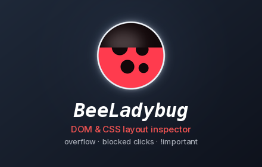

# Changelog

All notable changes to the Firefox build of BeeLadybug are documented in this file.

The format is based on [Keep a Changelog](https://keepachangelog.com/en/1.1.0/),
and this project adheres to [Semantic Versioning](https://semver.org/spec/v2.0.0.html).

Git history for this repository is a single commit, `first commit` (2026-11-23). That commit already contains extension version 1.0.5. The entry below lists the Firefox changes present in that source: `src/manifest.json` and `src/content.js`. `src/popup.html`, `src/popup.js`, `src/entity-bridge.js`, and `src/content.src.js` match the Chrome 1.0.5 package.

## [1.0.5] - 2026-11-23

### Added

- Firefox Manifest V3 settings under `browser_specific_settings.gecko` in `src/manifest.json`.
- Extension id `beeladybug-hud@beeenginejs.com`.
- `strict_min_version` set to `142.0`.
- `data_collection_permissions.required` set to `["none"]`, declaring that the add-on collects no data.

### Changed

- `src/content.js` no longer assigns HTML strings to `innerHTML`. The HUD (panel, sections, issue rows, inspect rows, event log, and adapter buttons) is built with `document.createElement`, `textContent`, and `replaceChildren`.
- The page scripts contain no `innerHTML`, `outerHTML`, or `insertAdjacentHTML`. Text from the page is set with `textContent`, so it is not parsed as HTML inside the overlay.
- The F8 HTML report is still a string. Values are escaped by `escapeHtml2` (`&`, `<`, `>`, `"`). The file is downloaded through a temporary `<a>` created with `createElement` and a `Blob`. The report string is not inserted into the page DOM.
## [1.0.5] - 2026-11-21

### Changed
- The HUD panel uses an opaque dark background (`#0d1117` at 96%) with a 6px backdrop blur, so text stays readable on white pages.
- Every HUD section keeps the opaque background and the 6px blur in normal, WIDE, COMPACT and PILL modes.
- Footer buttons and the header bar are raised, with a 12px minimum size and alternating rows in INSPECT and EVENTS.
- The header labels CORE, LIVE, WIDE, COMPACT and PILL use the same 6px corner radius as the footer buttons.
- The extension popup closes after it injects the HUD, so Space returns to the page instead of pressing the toolbar button again.
- `!important` longhands from the same CSS rule are shown as one row, with `×N` when the same rule or cause repeats.
- Click blocked is now a warning, "possible click blocked (verify)".
- The F8 HTML report filters every table by the severity counters and hides info rows behind "mostra info (N)".
- Identical `!important` rules in the report become one row, with the element list in a details block.

### Fixed
- A Space keydown in the content script only blurs a focused HUD button and no longer hides the panel.
- Stacking context is reported as info unless `elementFromPoint` shows the element is really covered.
- Click blockers ignore ancestors and descendants of the covered element, and SVG shapes are skipped.
- A cookie or consent banner no longer raises click blocked; the report keeps one info row, "cookie banner open, covering page".
- sr-only elements, `aria-hidden`, scroll containers and unloaded lazy images are no longer reported as visible bugs.
- `!important`, negative margins, stacking and overflow inside a scroller are reported as info.
- Skip-to-content links that are invisible until focus are left out of the report.

## [1.0.4] - 2026-11-21

### Added

- Chrome extension: a page with a canvas starts only CanvasAdapter (`autoPump`). DOM and CSS stay off until their HUD buttons. A page without a canvas starts DOM and CSS. Entities arrive from `window.__BEE_ENTITIES__` through a MAIN-world script that posts them every 100ms. Space and arrows no longer reactivate a focused HUD button.
- The HUD collapses repeated issues that share a selector and a message into one row with a count (`img.game-card__cover overflows viewport ×40`). `!important` physical longhands from the same rule and stylesheet render as one shorthand (`margin: 0px`); a missing side stays a longhand, and the F8 report keeps that shorthand plus any longhand from another sheet.

## [1.0.3] - 2026-11-21 

### Added

- Fixed: overlay canvas covered the game when the page styles all canvas elements. The same inline reset applies to the CanvasAdapter and WebDOMAdapter overlays. CSSAdapter draws with divs, so it has no canvas overlay to reset.

## [1.0.2] - 2026-11-21

### Added

- The HUD panel can be dragged from its header and stays inside the screen. A header control collapses it to a pill with the ladybug mark and the FPS; clicking the pill opens the panel again. Position and that state are restored from localStorage with the other panel settings.

## [1.0.0] - 2026-11-21

### Added
- The HUD panel resizes (360px default, up to 90vw and 90vh), and the EVENTS log grows with it.
- A WIDE/COMPACT control next to LIVE switches between 360px and 680px.
- Width, height and the WIDE/COMPACT choice are saved in localStorage and restored.

### Fixed
- The FPS graph redraws when the panel changes size.