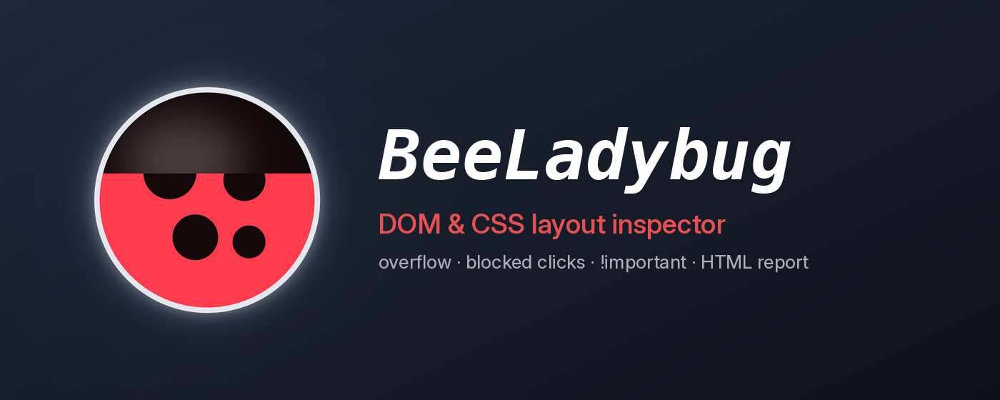

# BeeLadybug

BeeLadybug for Mozilla Firefox. Version 1.0.5. Manifest V3.

Inspect layout and CSS problems on the page you are looking at, then download an HTML report. This repository is the Mozilla add-on: Firefox loads `src/`, and the listing on Firefox Add-ons (addons.mozilla.org) is currently in review.

Firefox 142.0 is the minimum (`strict_min_version` in `src/manifest.json`). The add-on id is `beeladybug-hud@beeenginejs.com`. `data_collection_permissions` is `none`.

## What it finds

Open the HUD on a normal page and BeeLadybug starts two inspectors: CSS and DOM. A page that contains a `<canvas>` starts the canvas inspector instead, and leaves CSS and DOM off until you turn them on.

The CSS and DOM scans skip `script`, `style`, `link`, and `meta`, nodes with `display: none`, `visibility: hidden`, or a zero-size box, the WordPress admin bar (`#wpadminbar` and classes that start with `ab-`), and BeeLadybug's own overlay. The CSS section of a report keeps at most 80 rows. The DOM problem list stops at 40 rows.

### CSS

These checks run while you hover an element, when you press **S** to scan the page, and again when you export a report.

- **Viewport overflow.** The element extends more than 1px past the left or right edge of the viewport. `html` and `body` are ignored. If a child sticks out by the same amount, the parent is not listed again. Inside a container that clips overflow this is info. Otherwise it is an error.
- **Covered clicks.** The center of the element is covered by another element, so a click there would hit the cover. A fixed or absolute `::before` or `::after` on `html` or `body` counts. Ancestors, descendants, and SVG shapes (`svg`, `path`, `circle`, `ellipse`, `rect`, `polygon`) are skipped. The report text is "possible click blocked (verify)". The row is a warning.
- **Cookie banner.** If the cover looks like a cookie or consent banner (an id or class matching `cookie`, `consent`, `onetrust`, `ot-sdk`, or `cookiebot`), it is reported once as "cookie banner open, covering page" instead of as a blocked click.
- **Invisible text.** The element has text of its own, or it is a `button`, `a`, `label`, `input`, or `textarea`. The text is treated as invisible when opacity is 0 on the element or an ancestor, when the text color is transparent, or when the text color matches the background painted behind it. Screen-reader-only boxes and elements inside a clipping container are skipped.
- **`!important` rules.** Readable stylesheets are walked for declarations marked `!important`. Media queries are included only when they currently match. Each element that matches the selector is listed with the property, value, selector, and stylesheet. This is an info row. A stylesheet that throws when its rules are read is noted as "unreadable sheet", and its rules are skipped.
- **Negative margin.** A computed `margin-top`, `margin-right`, `margin-bottom`, or `margin-left` below zero. Screen-reader-only boxes, `aria-hidden="true"` content, and elements inside a clipping container are skipped. This is info.
- **Distorted image.** An `img` with `object-fit: fill` whose rendered width/height ratio differs from the image file's ratio by more than 5%. This is an error.
- **Stacking context.** The element has a `z-index` other than `auto`, and an ancestor creates a stacking context. The ancestor qualifies when it has a transform other than `none`, opacity below 1, a filter other than `none`, or a non-static position together with a `z-index`. If something else covers the element's center, the row is an error. Otherwise it is info. `will-change: transform` or `will-change: opacity` on an ancestor is reported as a hint.

### DOM

- **Box model.** Hovering an element outlines its margin, border, padding, and content, and the panel shows the border-box size and `display`.
- **Collapsed content.** The border box has both width and height, but the content box has a width or height of 0. A lazy-loaded `img` that has not loaded yet is skipped.
- **Content larger than the client box.** Reported with the rule name `clipped`. `scrollWidth` or `scrollHeight` is more than 2px above the client box. The row is added when the element itself does not use overflow `hidden`, `auto`, `scroll`, or `clip`, and no ancestor does either. Screen-reader-only boxes and `aria-hidden="true"` content are skipped.
- **Negative margin.** The same negative-margin check, included in the DOM snapshot as info.
- **Mutations.** A count of nodes added, nodes removed, and changes to `class`, `style`, `hidden`, `disabled`, and `open` under the observed root. A count above zero is a warning in the report.

### Canvas

When the page has a `<canvas>` that is not one of BeeLadybug's overlays, the HUD draws hitboxes for game entities.

`entity-bridge.js` reads `window.__BEE_ENTITIES__` every 100ms and posts a plain copy to the same page. The copy keeps `name`, `id`, `label`, `role`, `x`, `y`, `worldX`, `worldY`, `width` or `w`, `height` or `h`, `active`, `colliding`, and `primary`. A box is marked as colliding when its entity says `colliding`, or when two boxes overlap. The report includes each hitbox and, once frames have been sampled, the FPS min, average, and max. If the page never sets `__BEE_ENTITIES__`, the event log says `nessuna entità: il gioco deve esporre window.__BEE_ENTITIES__`.

## How to use

1. Open a normal website in Firefox. The add-on does not inspect Firefox internal pages. The popup status line on those pages still names Chrome. See [What the popup shows](#what-the-popup-shows).
2. Click the BeeLadybug toolbar icon, then click **Attiva/Disattiva HUD**. The popup injects the scripts into that tab and closes. Click the icon and the same button again to remove the HUD.
3. Read the panel on the page. **STATUS** shows frame rate and the simulated clock. **ISSUES** lists causes found while you hover, or after a scan. **INSPECT** shows the findings for the element under the pointer. **EVENTS** is the log. On a normal page, DOM and CSS start on. Move the pointer to see the box model. Press **S** to scan the whole page (this is ignored while you are typing in a field). Press **P** to pin the current element. **F6** turns the CSS hunt on or off. **F2** hides or shows the overlay. Drag the panel, or use **WIDE** and **PILL** to resize it. On a page with a canvas, the canvas view starts first. Use the **DOM** and **F6 CSS** buttons to turn the other inspectors on.
4. Export the HTML report. Click **F8 EXPORT** or press **F8**. The tab downloads `report-YYYYMMDD-HHMM.html`. The file is built in the page. It contains the URL, the viewport, the log, and a snapshot from each attached inspector. The CSS snapshot runs even when the live hunt is off. Info rows stay hidden until you click "mostra info (N)". Severity buttons filter the tables.

**F3 SLOW** sets the simulated clock to 0.25×. **F4 STOP** freezes that clock. **1x LIVE** restores it. Freeze stops the simulated clock only. The overlay keeps running.

The panel markup still has an Ask AI button. This build hides it. No assistant is registered.

Space, Arrow Up, Arrow Down, Arrow Left, and Arrow Right do not activate a focused HUD button. A click on a HUD button blurs it, so the next Space key goes to the page.

## What the popup shows

The button in `src/popup.html` is **Attiva/Disattiva HUD**. That label does not name Chrome, Edge, or Firefox.

On a page the add-on will not inspect, `src/popup.js` leaves the popup open and writes this sentence into the status line:

> Questa pagina non si può ispezionare (chrome://, Chrome Web Store o un'altra pagina protetta). Aprilo su un sito normale.

That sentence names Chrome. The function `blockedUrl` shows it when the address starts with `chrome:`, `chrome-extension:`, `edge:`, `about:`, `devtools:`, or `view-source:`, and when the host is `chrome.google.com` or `chromewebstore.google.com`.

In Firefox the pages this stops are `about:` pages, including `about:debugging`, `about:config`, and `about:addons`. Firefox does not open its own screens on `chrome://` or `edge://`. Those prefixes sit in the same check so an internal page is refused if the address uses them. The words "Chrome Web Store" appear only in that status sentence.

The zip already sent to Mozilla contains this sentence. A different wording needs a new package. This page describes the popup in that package.

The script calls `chrome.tabs.query` and `chrome.scripting.executeScript`. In a Firefox Manifest V3 add-on, `chrome` is the WebExtensions API name Firefox provides, next to `browser`. That name is not drawn in the popup. The only Chrome words a person can read are in the status sentence above.

## Test it on Firefox

`src/` is the add-on. Firefox can load that folder by itself.

1. Open Firefox and go to `about:debugging`.
2. Click **This Firefox**.
3. Click **Load Temporary Add-on**.
4. Select `src/manifest.json`.

Open a normal web page, click the BeeLadybug icon, then click **Attiva/Disattiva HUD**. `about:debugging` itself is an `about:` page, so the popup will refuse to inspect that tab.

After you edit a file, reload the temporary add-on on `about:debugging`. Then turn the HUD off and on again, so the page picks up the new `content.js` and `entity-bridge.js`.

Firefox 142.0 is the minimum in `src/manifest.json` (`strict_min_version`).

## Permissions

The manifest asks for two permissions:

- **`activeTab`.** After you click the toolbar icon, Firefox grants access to the tab you are looking at. The extension does not run on other tabs, and it does not run until you click it.
- **`scripting`.** The popup calls `chrome.scripting.executeScript`. Firefox provides that method on the `chrome` namespace. The call injects `entity-bridge.js` and then `content.js` into that tab. Both files run in the page's main JavaScript world (`world: "MAIN"`), so the bridge can read `window.__BEE_ENTITIES__` when a game exposes it.

There are no host permissions and no `storage` permission. The panel remembers its size and position in that page's `localStorage`, under the key `bee-ladybug.panel`. The HTML report is a local download. Entity data is posted to the same window with `postMessage`. The HUD accepts that message only when `event.source` is the same window.

BeeLadybug does not send page content, reports, or entity data to any server.

## Why this Firefox version is different from Chrome

Mozilla reviews the add-on for unsafe DOM writes and for a data-collection declaration. `src/manifest.json` and `src/content.js` were adapted for that review. `src/popup.html` and `src/popup.js` were not rewritten, so the blocked-page sentence still says Chrome and the URL check still includes `edge:`. See [What the popup shows](#what-the-popup-shows). `entity-bridge.js` and `content.src.js` are the same files as in the Chrome 1.0.5 package.

### `src/manifest.json`

The Firefox manifest adds `browser_specific_settings.gecko`:

- **`id`:** `beeladybug-hud@beeenginejs.com`
- **`strict_min_version`:** `142.0`
- **`data_collection_permissions.required`:** `["none"]`

That last field tells the review the add-on collects no data. The name, version `1.0.5`, description, `activeTab`, `scripting`, popup, and icons are the same fields the Chrome manifest uses.

### `src/content.js`

The Chrome build draws the HUD by assigning an HTML string to `innerHTML`, and it updates the issue list, the inspect rows, the event log, and the adapter buttons the same way. This file does not. `content.js`, `content.src.js`, `popup.js`, `popup.html`, and `entity-bridge.js` contain no `innerHTML`, no `outerHTML`, and no `insertAdjacentHTML`.

The overlay is a `bee-ladybug-overlay` element. The panel, buttons, and sections are created with `document.createElement`. Labels go in with `textContent`. When a list changes, the code calls `replaceChildren` with the new nodes. Page text therefore cannot become markup inside the HUD.

The F8 report is still an HTML document. `renderHtml` builds that document as a string, and every inserted value passes through `escapeHtml2` (`&`, `<`, `>`, and `"`). The download uses a temporary `<a>` created with `createElement`, a `Blob`, and `URL.createObjectURL`. The report string is saved as a file. It is not inserted into the page.

The bundled engine version string inside `content.js` is `0.6.14`. The checks, shortcuts, and report contents are the ones described above.

## Project structure

This is a plain JavaScript extension. There is no `package.json` and no build step. Firefox loads the files in `src/` as they are. The repository root holds `src/` and the project files listed under Project docs.

| File | What it does |
| --- | --- |
| `src/manifest.json` | Manifest V3 entry. Name, version 1.0.5, `activeTab` and `scripting`, the popup, the icons, and the Firefox `gecko` settings. |
| `src/popup.html` | The small popup. One button, **Attiva/Disattiva HUD**, and a status line. Styles are in the page. |
| `src/popup.js` | Checks that the tab can be inspected, injects the two page scripts, then closes the popup. On a blocked page it shows the Italian sentence that names `chrome://` and the Chrome Web Store. Clicking again removes the HUD. |
| `src/content.js` | The script Firefox injects. It contains the HUD, the DOM, CSS, and canvas inspectors, the HTML report, and the on/off boot. The HUD is built with `createElement`, `textContent`, and `replaceChildren`. |
| `src/content.src.js` | The extension boot written as an ES module (`pagePlan`, entity messages, hiding the Ask button). It imports the engine from `../src/index.js`, which is not in this repository. The popup injects `content.js`, not this file. |
| `src/entity-bridge.js` | Runs in the page. Copies `window.__BEE_ENTITIES__` into a `postMessage` every 100ms. |
| `src/icons/` | `icon16.png`, `icon48.png`, and `icon128.png`. |

Paths inside `src/manifest.json` (`popup.html`, `icons/icon16.png`, `icons/icon48.png`, `icons/icon128.png`) and inside `src/popup.html` (`popup.js`) are relative to `src/`. `popup.js` injects `entity-bridge.js` and `content.js` from the extension root. Loading `src/manifest.json` makes `src/` that root, so those paths still resolve.

## Project docs

- [Changelog](CHANGELOG.md)
- [Contributing](CONTRIBUTING.md)
- [Code of conduct](CODE_OF_CONDUCT.md)
- [Security](SECURITY.md)
- [License](LICENSE) (MIT, copyright 2026 Antonio Prosperi)
